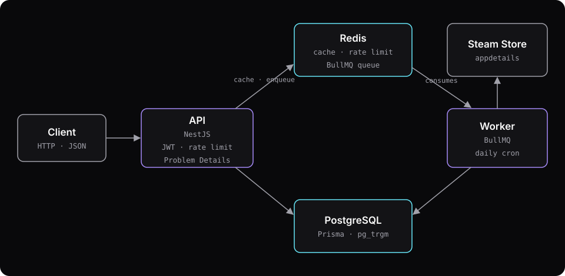

## Context

Checkpoint is a game catalog that stays in sync with public data from the Steam store. It serves the catalog through a paginated, cached HTTP API, and lets registered users review games and keep a personal library (backlog, playing, completed, dropped).

The goal is to show, in a codebase small enough to read in under an hour, the habits of a production system: data modeling, migrations, authentication, caching, background jobs, observability, tests, CI and documentation. The project isn't affiliated with Valve or Steam and stores only public metadata.

## My role

Solo project: specification, architecture, implementation, tests and documentation.

## Architecture

- **Deny-by-default authentication.** Every new route is protected and only becomes public with `@Public()`. A forgotten decorator fails closed, not open.
- **Opaque, rotating refresh token in a cookie.** The access token is a 15-minute JWT kept in memory by the client. The refresh token is random, only its hash is stored, and every use issues a new one. Presenting a token that was already used revokes the whole family, which exposes token theft.
- **Cursor pagination, not offset.** Each sort order has a `(key, id)` index, so the next page starts at the cursor instead of scanning everything before it. The query plans are documented in the repo.
- **Worker in a separate process.** A sync makes about 200 calls to Steam, 2 seconds apart: around 7 minutes of mostly waiting. The API only enqueues; the worker consumes the BullMQ queue, so syncing doesn't compete with catalog reads.
- **Denormalized rating.** The average and count of reviews live on the game row and are recomputed in the same transaction as the review write. Sorting by rating uses an index instead of aggregating on every read.

Each of these decisions has an ADR in the repo, with the alternatives considered.

## Challenges and solutions

### Integrating with an undocumented endpoint

Steam's `appdetails` endpoint isn't documented or supported by Valve. Before writing the client, I tested how it actually behaves and recorded it in an ADR: one game per request (several ids return 400), an id without a store page returns 200 with `success: false`, and there's no rate limit header. The catalog follows a curated list of 211 games, with one request every 2 seconds and retries after 5, 15 and 45 seconds. Every response is validated with zod; an invalid game is counted and skipped without failing the sync.

### One sync at a time, enforced by the database

A unique job id isn't enough: two simultaneous `POST /admin/sync` calls could still create two runs. I added a lock column with a unique index and a `CHECK` tied to the status, so PostgreSQL itself rejects the second run, and the API turns that into a 409.

### A cache that doesn't take the API down

The cache uses versioned keys (`games:v{n}:...`): invalidating means bumping the version, with no key scans. If Redis goes down, reads fall through to PostgreSQL and the API keeps answering. Login rate limits, on the other hand, fail closed when Redis is down, because not limiting logins is worse than refusing them for a few seconds.

## Results

- 381 tests, with 98.2% line coverage and 86.3% branch coverage.
- k6 load test on the 211-game dataset: p95 of 39.2 ms uncached and 3.5 ms cached, with no errors.
- Production Docker image running as non-root, with no dev dependencies and no source code; PostgreSQL and Redis have no exposed ports.
- OpenAPI document versioned in the repo, with a test that fails if it drifts from the served API.

The API is done; the web UI and the public demo at `checkpoint.gustavofranca.tech` are next.

## What I'd do differently

I'd rethink the per-account login lockout: five failed attempts lock the email for 15 minutes, and someone else can trigger that on purpose. I'd also tighten database permissions, since the role the app uses can still write to the migrations bookkeeping table.
