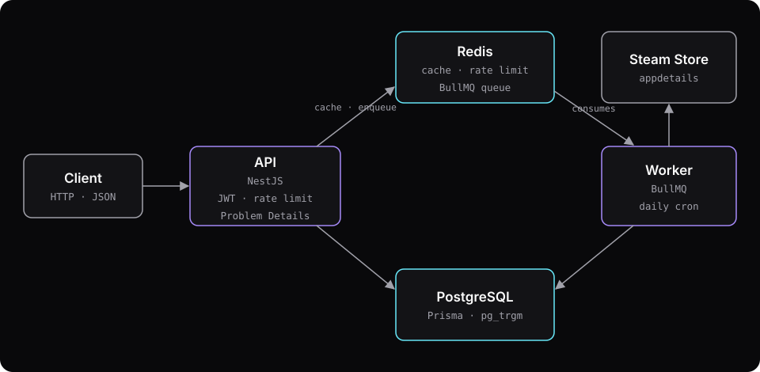

## Contexto

O Checkpoint é um catálogo de jogos que se mantém sincronizado com os dados públicos da loja da Steam. Ele serve o catálogo por uma API HTTP paginada e com cache, e deixa usuários cadastrados avaliarem jogos e manterem uma biblioteca pessoal (na fila, jogando, zerado, abandonado).

O objetivo é mostrar, num código pequeno o bastante para ser lido em menos de uma hora, os hábitos de um sistema de produção: modelagem, migrations, autenticação, cache, jobs em segundo plano, observabilidade, testes, CI e documentação. O projeto não tem relação com a Valve nem com a Steam e guarda só metadados públicos.

## Meu papel

Projeto individual: especificação, arquitetura, implementação, testes e documentação.

{/* TODO(gustavo): confirmar «projeto individual» e como apresentar o uso de agente de IA (a maioria dos commits vem de outra conta do GitHub e o repositório tem CLAUDE.md e PROGRESS.md do agente) */}

## Arquitetura

- **Autenticação negada por padrão.** Toda rota nova nasce protegida e só fica pública com `@Public()`. Esquecer um decorador falha fechado, não aberto.
- **Refresh token opaco e rotativo, em cookie.** O access token é um JWT de 15 minutos guardado em memória pelo cliente. O refresh token é aleatório, só o hash vai para o banco, e cada uso emite um novo. Reapresentar um token já usado revoga a família inteira, o que denuncia roubo de token.
- **Paginação por cursor, não por offset.** Cada ordenação tem um índice `(chave, id)`, então a página seguinte começa no cursor em vez de varrer o que ficou para trás. Os planos de consulta estão documentados no repositório.
- **Worker em processo separado.** Uma sincronização faz cerca de 200 chamadas à Steam com 2 segundos de intervalo, uns 7 minutos quase só de espera. A API só enfileira; o worker consome a fila BullMQ, então a sincronização não disputa recursos com quem está lendo o catálogo.
- **Nota média desnormalizada.** A média e a contagem de avaliações ficam na tabela do jogo e são recalculadas na mesma transação da escrita da avaliação. A ordenação por nota usa índice em vez de agregar a cada leitura.

Cada uma dessas decisões tem um ADR no repositório, com as alternativas consideradas.

## Desafios e soluções

### Integrar com um endpoint que não tem documentação

O `appdetails` da Steam não é documentado nem suportado pela Valve. Antes de escrever o cliente, testei o comportamento real e registrei num ADR: um jogo por requisição (vários ids dão 400), id sem página responde 200 com `success: false`, e não há cabeçalho de limite. O catálogo segue uma lista curada de 211 jogos, com uma requisição a cada 2 segundos e novas tentativas após 5, 15 e 45 segundos. Cada resposta é validada com zod; um jogo inválido é contado e pulado, sem derrubar a sincronização.

### Uma sincronização por vez, garantida pelo banco

Só o id único do job não basta: duas chamadas simultâneas a `POST /admin/sync` poderiam criar duas execuções. Coloquei uma coluna de trava com índice único e um `CHECK` amarrado ao status, então o próprio PostgreSQL recusa a segunda execução, e a API transforma isso em 409.

### Cache que não derruba a API

O cache usa chaves versionadas (`games:v{n}:...`): invalidar é incrementar a versão, sem varrer chaves. Se o Redis cai, as leituras vão direto ao PostgreSQL e a API segue respondendo. Os limites de tentativa de login, ao contrário, falham fechados com o Redis fora, porque deixar de limitar login é pior do que recusar por alguns segundos.

## Resultado

- 381 testes, com 98,2% de cobertura de linhas e 86,3% de ramos.
- Teste de carga com k6 sobre a base de 211 jogos: p95 de 39,2 ms sem cache e 3,5 ms com cache, sem erros.
- Imagem Docker de produção sem root, sem dependências de desenvolvimento e sem código-fonte; PostgreSQL e Redis sem porta exposta.
- OpenAPI versionado no repositório, com um teste que falha se ele divergir da API servida.

A API está pronta; a interface web e o demo público em `checkpoint.gustavofranca.tech` são os próximos passos.

## O que eu faria diferente

{/* TODO(gustavo): confirmar esta seção (rascunho escrito a partir das limitações documentadas no repositório) */}

Reveria o bloqueio de login por conta: cinco tentativas erradas bloqueiam o e-mail por 15 minutos, e outra pessoa pode provocar esse bloqueio de propósito. Também separaria melhor as permissões do banco, porque o papel que a aplicação usa ainda consegue escrever na tabela de controle das migrations.
