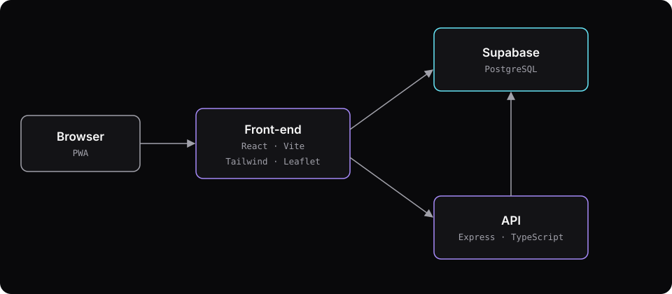
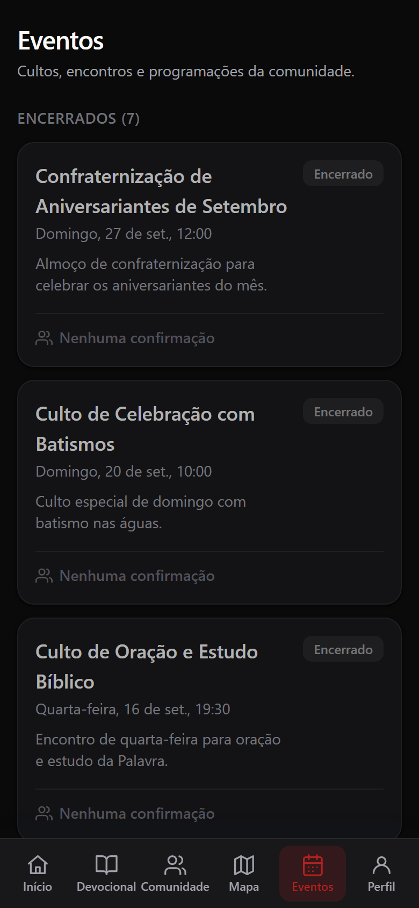

## Context

Conexão Metodista brings together what the church community uses day to day: the daily devotional, notices, groups, prayer requests, an events calendar with RSVPs, a map of churches and small groups, a membership card, and tithing via PIX (Brazil's instant payment system). It started as a university outreach project.

The app is built for phones: tab navigation at the bottom, light and dark themes, and it can be installed on the home screen as a PWA.

## My role

Built as a pair with a friend. The code lives in private repositories, so there's no link to it here.

TODO(gustavo): o que exatamente foi feito por você (em inglês)

## Architecture

- **React front-end with Vite and Tailwind**, shipped as a PWA: it has a manifest and a service worker, so it opens like an app on the phone.
- **Supabase** as the database and data service, accessed by the front-end itself.
- **Express and TypeScript API** on the back-end.
- **Map built with Leaflet**, using OpenStreetMap and CARTO tiles, to show the churches and small groups in the city.

TODO(gustavo): confirmar o diagrama e o porquê de cada decisão (em inglês)

## Challenges and solutions

TODO(gustavo): desafios técnicos do Conexão (em inglês)

## Results

The app is live at [conexaometodista.com.br](https://www.conexaometodista.com.br), on its own domain.

## What I'd do differently

TODO(gustavo): o que você faria diferente no Conexão (em inglês)
