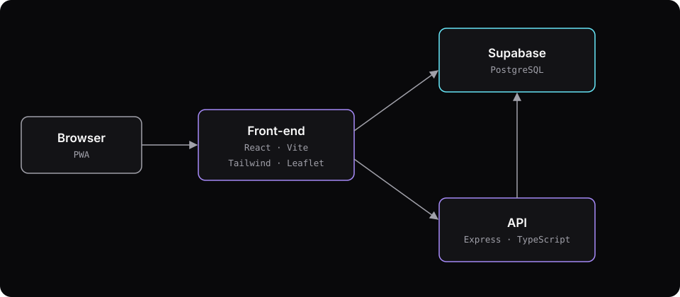
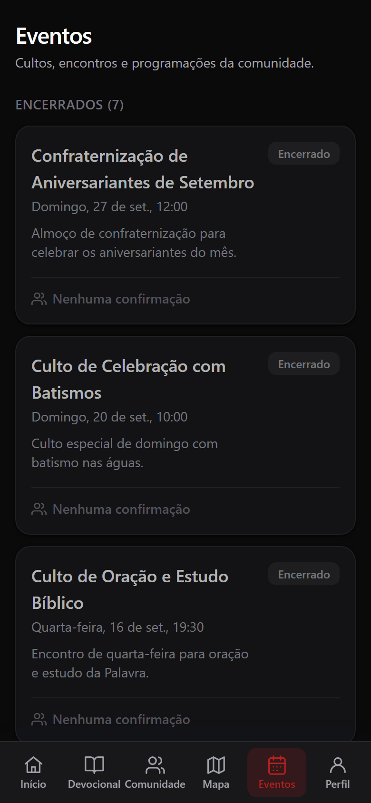

## Contexto

O Conexão Metodista reúne num só lugar o que a comunidade da igreja usa no dia a dia: a devocional do dia, avisos, grupos, pedidos de oração, agenda de eventos com confirmação de presença, mapa das igrejas e células, carteirinha de membro e dízimo por PIX. Nasceu como projeto de extensão da faculdade.

O app é pensado para o celular: navegação por abas no rodapé, tema claro e escuro, e pode ser instalado na tela inicial como PWA.

## Meu papel

Projeto em dupla com um amigo. O código fica em repositórios privados, por isso não há link para ele aqui.

TODO(gustavo): o que exatamente foi feito por você (telas, API, banco, deploy) e o que ficou com o seu amigo

## Arquitetura

- **Front-end em React com Vite e Tailwind**, publicado como PWA: tem manifesto e service worker, então abre como app no celular.
- **Supabase** como banco e serviço de dados, acessado pelo próprio front-end.
- **API em Express e TypeScript (a confirmar).** O front publicado só faz chamadas ao Supabase, então o papel dessa API ainda precisa ser confirmado.
- **Mapa com Leaflet** e mapas do OpenStreetMap e CARTO, para mostrar as igrejas e células da cidade.

TODO(gustavo): confirmar o diagrama e o porquê de cada decisão (o front publicado fala direto com o Supabase; qual é o papel da API Express?)

## Desafios e soluções

TODO(gustavo): dois ou três desafios técnicos do Conexão que você resolveu, com a solução de cada um

## Resultado

O app está no ar em [conexaometodista.com.br](https://www.conexaometodista.com.br), com domínio próprio.

## O que eu faria diferente

TODO(gustavo): o que você faria diferente no Conexão Metodista
