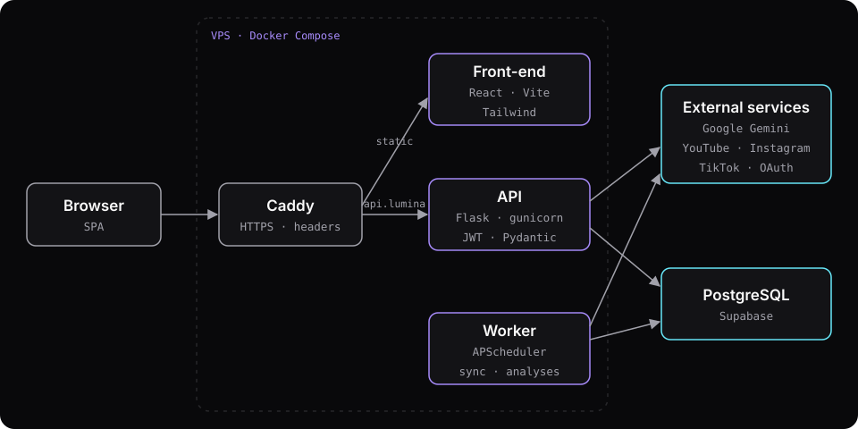
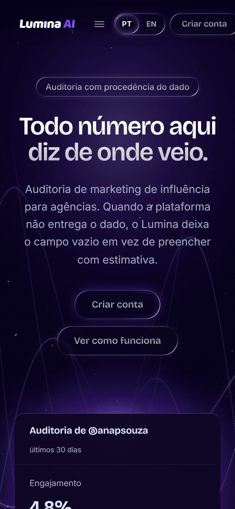

## Context

Agencies that hire influencers usually decide based on what the creator sends them: a screenshot of reach, a spreadsheet, numbers nobody can verify. Lumina lets those agencies audit campaigns with data collected straight from the platforms, with the date and source of every value.

One rule drives the whole product: when a platform doesn't provide a metric, the field stays empty. The system doesn't fill it with an estimate and never shows zero in place of "not measured".

## My role

Solo project. I built it end to end: database modeling, API, front-end, the social media and Gemini integrations, tests, decision records, and the deployment on my own VPS.

## Architecture

- **Modular monolith instead of microservices.** One developer, fixed deadline. Each domain (campaigns, creators, AI analysis, reports) has its own models, schemas and services, and modules only talk to each other through the service layer. I get the boundaries without paying for network calls and orchestration.
- **Managed PostgreSQL on Supabase.** I developed on two machines and would present on a third. A single database removes state drift between them. The local container stays in the repo as a fallback for offline work.
- **Three-layer strategy.** Layer one (database plus demo data) always works; layer two connects the social APIs via OAuth; layer three calls Gemini. If an external integration goes down, the demo still stands.
- **Missing data is `null`, never zero.** I found four screens showing "0%" where nothing had been measured. I unified the convention in the back-end and the UI now shows a dash.
- **Docker and Caddy on the VPS.** Three containers: Caddy (automatic HTTPS and security headers), the API on gunicorn, and a worker that only runs jobs.

## Challenges and solutions

### The dashboard took 15 seconds to load

Against the managed database, `/dashboard/overview` ran 70 queries per request: three separate queries (posts, analyses and social accounts) for each creator in the agency. At 225 ms per round trip to Supabase, almost all of the time was network wait. I switched to batch loading, with `selectinload` on social accounts, and went down to 13 queries and from 15 s to 3.2 s. Campaign benchmarking had another N+1 (`3 + 5n` queries); it now runs a fixed 7 queries and the response dropped from 3.6 s to 1.4 s, checked field by field against the previous version.

### Jobs ran once per process

Under gunicorn, each HTTP worker started its own scheduler, so every job ran several times. On Gemini's free tier (20 requests a day), that would burn the quota in minutes. I moved the scheduler into its own process, enabled by an environment variable, and in production it runs in a separate container.

### Account security

Sign-up returns the same response for a new email and for one that's already registered, and the work that differs between the two runs in the background, so not even response time gives away who has an account. Two-factor authentication (TOTP) is mandatory for admins, following OWASP's recommendation and NIST's AAL2 level. I tested IDOR while authenticated as another agency across 26 endpoints and 6 listings, with zero leaks.

## Results

Lumina is live at [lumina.gustavofranca.tech](https://lumina.gustavofranca.tech).

- Back-end with 441 tests and 95% coverage.
- Front-end with 80 end-to-end tests in Playwright, including AA contrast in both themes.
- Real data collection from YouTube via OAuth. Instagram and TikTok depend on the platforms' App Review.
- 14 architecture decisions recorded as ADRs in the repo.

## What I'd do differently

I'd start the front-end in TypeScript. It stayed in JavaScript for this phase, and types shared with the API would catch contract errors in the editor that today only the tests catch. I'd also start Meta's and TikTok's App Review earlier: it requires a public domain and business verification, and it's what left two of the three platforms without real data collection.
