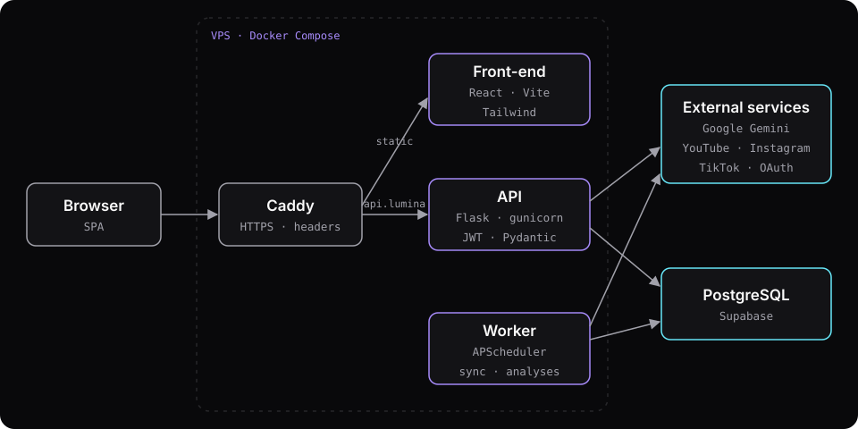
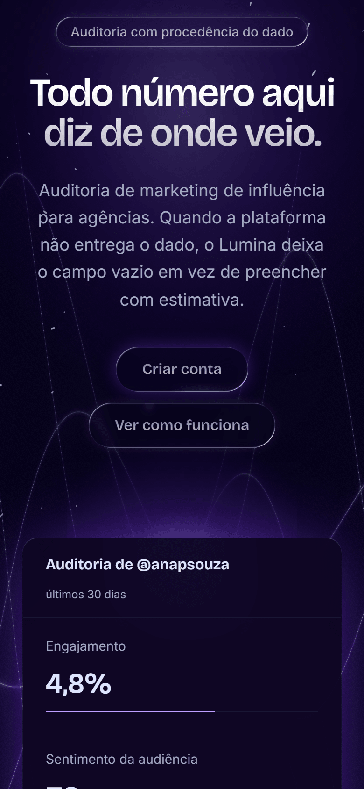

## Contexto

Agências que contratam influenciadores costumam decidir com base no que o próprio criador manda: print de alcance, planilha, número que ninguém consegue conferir. O Lumina é uma plataforma para essas agências auditarem campanhas com dados coletados direto das plataformas, com a data e a origem de cada valor.

A regra que guia o produto inteiro: quando a plataforma não entrega um dado, o campo fica vazio. O sistema não preenche com estimativa e não mostra zero no lugar de "não medido".

## Meu papel

Projeto individual. Fiz o produto de ponta a ponta: modelagem do banco, API, front-end, integração com as APIs sociais e com o Gemini, testes, documentação das decisões e o deploy no meu VPS.

## Arquitetura

- **Monolito modular em vez de microsserviços.** Era um desenvolvedor só, com prazo fechado. Cada domínio (campanhas, criadores, análise de IA, relatórios) tem seus models, schemas e services, e um módulo só fala com outro pela camada de serviços. Tenho a fronteira sem pagar o custo de rede e orquestração.
- **PostgreSQL gerenciado no Supabase.** Desenvolvi em duas máquinas e a apresentação seria numa terceira. Um banco só elimina a divergência de estado entre elas. O contêiner local continua no repositório como plano B para trabalhar sem rede.
- **Estratégia em três camadas.** A primeira (banco e dados de demonstração) sempre funciona; a segunda liga as APIs sociais por OAuth; a terceira chama o Gemini. Se uma integração externa cai, a demonstração continua de pé.
- **Ausência de dado é `null`, nunca zero.** Encontrei quatro telas que mostravam "0%" onde nada tinha sido medido. Unifiquei a convenção no back-end e a interface passou a mostrar o traço.
- **Deploy com Docker e Caddy no VPS.** Três contêineres: Caddy (HTTPS automático e cabeçalhos de segurança), API com gunicorn e um worker só para os jobs.

## Desafios e soluções

### O painel levava 15 segundos para abrir

Contra o banco gerenciado, o `/dashboard/overview` fazia 70 consultas por requisição: para cada criador da agência, três consultas separadas (posts, análises e contas sociais). Com 225 ms por ida e volta até o Supabase, quase todo o tempo era espera de rede. Passei a buscar em lote, com `selectinload` nas contas sociais, e caí para 13 consultas e de 15 s para 3,2 s. No benchmarking de campanha havia outro N+1 (`3 + 5n` consultas); ficaram 7 consultas fixas e a resposta caiu de 3,6 s para 1,4 s, conferida campo a campo contra a versão anterior.

### Os jobs rodavam uma vez por processo

Sob gunicorn, cada worker HTTP criava o próprio agendador, então todo job rodava várias vezes. Com o plano gratuito do Gemini (20 requisições por dia), isso esgotaria a cota em minutos. Separei o agendador num processo próprio, ligado por variável de ambiente, e em produção ele roda num contêiner à parte.

### Segurança da conta

O cadastro responde igual para e-mail novo e para e-mail já cadastrado, e o trabalho que difere entre os dois casos roda em segundo plano, para nem o tempo de resposta denunciar quem tem conta. O segundo fator (TOTP) é obrigatório para administradores, seguindo a recomendação do OWASP e o nível AAL2 do NIST. Testei IDOR autenticado como outra agência em 26 endpoints e 6 listagens, sem nenhum vazamento.

## Resultado

O Lumina está no ar em [lumina.gustavofranca.tech](https://lumina.gustavofranca.tech).

- Back-end com 441 testes e 95% de cobertura.
- Front-end com 80 testes de ponta a ponta em Playwright, incluindo contraste AA nos dois temas.
- Coleta real do YouTube por OAuth. Instagram e TikTok dependem do App Review das plataformas.
- 14 decisões de arquitetura registradas em ADRs no repositório.

## O que eu faria diferente

{/* TODO(gustavo): confirmar esta seção (rascunho escrito a partir das limitações documentadas nos repositórios) */}

Começaria o front-end em TypeScript. Ele ficou em JavaScript nesta fase, e tipos compartilhados com a API pegariam no editor erros de contrato que hoje só os testes pegam. Também iniciaria antes o processo de App Review da Meta e do TikTok, porque ele depende de domínio público e verificação de negócio, e foi o que deixou duas das três plataformas sem coleta real.
